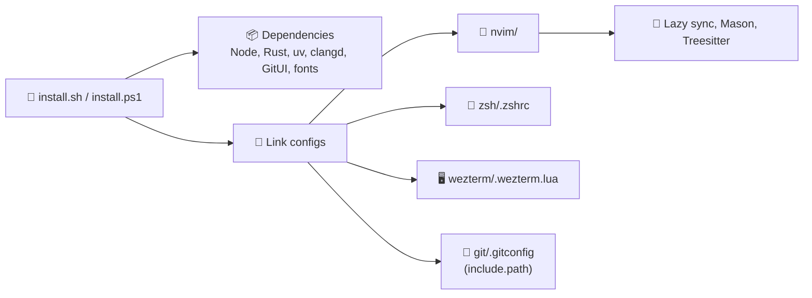

# 🛠️ PersonalSetup


**My dotfiles and one-command dev environment.** A modular Neovim config with LSP and debugging, a Zsh setup, a WezTerm config, and a shared Git config. One installer per platform sets up the toolchain and links everything into place.

---

## ✨ What you get

| | Piece | Details |
|---|---|---|
| 📝 | **Neovim 0.11+** | Lazy.nvim plugin manager, Tokyo Night theme, Lualine, Bufferline, Neo-tree, Telescope, Treesitter |
| 🧠 | **LSP** | clangd, rust-analyzer, pyright, ts_ls, HTML, CSS and lua_ls, managed by Mason |
| 🐞 | **Debugging** | nvim-dap with codelldb (C++ and Rust), debugpy (Python) and js-debug-adapter (JavaScript and React) |
| 🐚 | **Zsh** | Oh My Zsh with the `bira` theme and the `git`, `podman`, `tmux`, syntax-highlighting and autosuggestions plugins |
| 🖥️ | **WezTerm** | Tokyo Night colors, JetBrainsMono Nerd Font, translucent window and a compact tab bar |
| 🌿 | **Git** | Shared aliases and sane defaults, included from your global config |
| 📦 | **Toolchain** | Node 24+ through NVM, Rust through rustup, `uv` with Python 3.13, clangd, GitUI and the `command-code` CLI |

---

## 🗺️ How it works



Existing configs are backed up (`.bak`) before they are replaced by links, so the installers are safe to rerun.

---

## 🚀 Quick setup

### 🐧 Linux, macOS and Termux

```bash
chmod +x ./install.sh
./install.sh
```

The script detects `dnf`, `apt`, `pacman`, `zypper` or Homebrew and installs build dependencies, then everything above. On **Termux** it runs rootless and uses native packages for Node, Neovim, Rust and clangd instead of building them.

### 🪟 Windows

```powershell
Set-ExecutionPolicy Bypass -Scope Process -Force
.\install.ps1
```

You can also double-click `setup.bat`, which runs the same script. It installs tools through Winget, links the Neovim config into `%LOCALAPPDATA%\nvim` (a symlink, or a junction if symlinks aren't allowed), and copies the WezTerm config to `~\.wezterm.lua`. Run PowerShell as Administrator, or enable Developer Mode, so links can be created.

---

## 🗂️ Repository layout

```
nvim/
  init.lua                    entry point
  lua/config/                 lazy.lua, options.lua, keymaps.lua
  lua/plugins/                ui, telescope, treesitter, lsp, dap
zsh/.zshrc                    Oh My Zsh, NVM hooks
wezterm/.wezterm.lua          terminal config
git/.gitconfig                aliases and defaults
install.sh                    Linux, macOS and Termux installer
install.ps1, setup.bat        Windows installer
```

---

## ⌨️ Keyboard shortcuts (leader is Space)

### 🧭 Navigation

| Keys | Action |
|---|---|
| `jk` or `kj` | Leave insert mode |
| `Esc` | Clear search highlights |
| `Space e` | Toggle the Neo-tree explorer |
| `Ctrl h/j/k/l` | Move between windows |
| `Shift h/l` | Previous and next buffer |
| `Space bd` | Close the buffer |
| `Space sv` / `sh` / `se` / `sx` | Split vertically, split horizontally, equalize, close split |

### 🔍 Telescope

| Keys | Action |
|---|---|
| `Space ff` | Find files |
| `Space fg` | Live grep |
| `Space fb` | Open buffers |
| `Space fh` | Help tags |

### 🧠 LSP

| Keys | Action |
|---|---|
| `gd` | Go to definition |
| `K` | Hover documentation |
| `Space ca` | Code action |
| `Space rn` | Rename symbol |
| `[d` / `]d` | Previous and next diagnostic |
| `Space d` / `Space q` | Line diagnostics, diagnostics list |

### 🐞 Debugger

| Keys | Action |
|---|---|
| `F5` | Start or continue |
| `F10` / `F11` / `F12` | Step over, into, out |
| `Space b` | Toggle breakpoint |
| `Space du` | Toggle the debugger UI |

---

## 🌿 Git aliases

| Alias | What it does |
|---|---|
| `git st` | Short status with branch info |
| `git lg` | Graph log with relative dates and authors |
| `git br` | Branches with tracking info |
| `git bc` | Local branches sorted by latest commit |
| `git brlog [N or date]` | Branch activity, optionally the newest N or since a date |
| `git amend`, `git ca` | Amend the last commit without editing the message |
| `git pf` | Force push with `--force-with-lease` |
| `git pfi` | Force push with `--force-if-includes` |
| `git rs`, `git rh` | Soft and hard reset |
| `git unstage` | Unstage files |
| `git last` | One-line summary of the latest commit |

The config also turns on `rerere`, the `zdiff3` conflict style, the `histogram` diff algorithm and `push.autoSetupRemote`.
